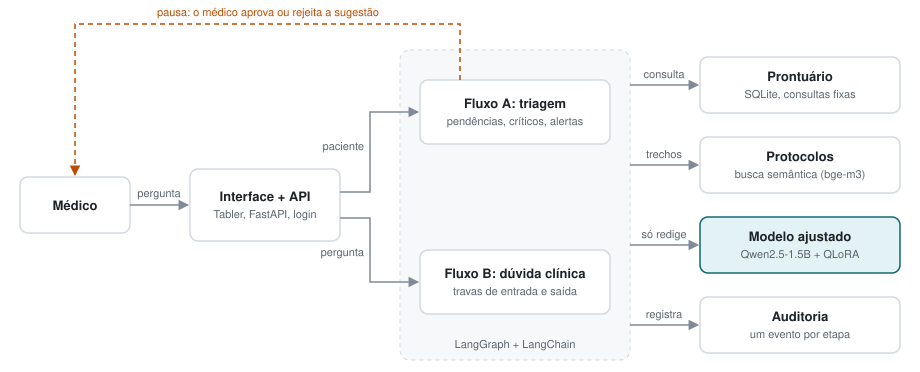
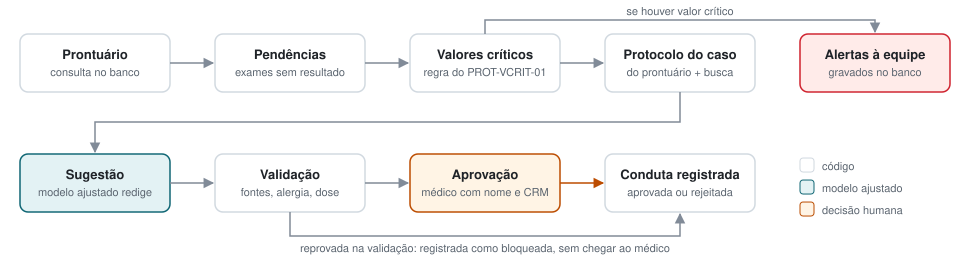

# Assistente médico virtual: Hospital Santa Aurora

Assistente clínico que responde dúvidas de médicos com base nos protocolos internos e no prontuário do paciente, executa uma triagem automatizada e **nunca registra uma conduta sem a aprovação de um médico**. Feito com um LLM ajustado por fine-tuning, LangChain e LangGraph, rodando 100% local.

**[Demonstração](https://william-devops-hospital-assistant.hf.space)** | **[Relatório técnico](docs/relatorio.md)** | **[Enunciado](desafio/)**

> Projeto acadêmico (Tech Challenge Fase 3, Pós Tech IA para Devs, FIAP). O hospital e todos os dados são fictícios: não usar na prática clínica.

## O que faz

- **Dúvida clínica**: responde com base nos protocolos e, com um paciente selecionado, no prontuário dele, sempre citando a fonte (`[PROT-SEPSE-01 §4]`).
- **Triagem automatizada**: verifica exames pendentes e valores críticos, alerta a equipe, sugere a conduta do protocolo e para até o médico aprovar ou rejeitar.
- **Segurança em camadas**: recusa prescrições e tentativas de burlar regras sem consultar o modelo, bloqueia respostas sem fundamento e calcula valores críticos em código.
- **Auditoria**: cada etapa registra quem pediu, o que o modelo recebeu e respondeu, as fontes, a validação e a decisão do médico.

## Arquitetura

<picture>
  <source media="(prefers-color-scheme: dark)" srcset="docs/diagramas/arquitetura-escuro.svg">
  
</picture>

O modelo ajustado só redige o texto: os fatos vêm do prontuário (SQLite) e dos protocolos (busca semântica), e a decisão é sempre do médico.

## Fluxo de triagem

<picture>
  <source media="(prefers-color-scheme: dark)" srcset="docs/diagramas/triagem-escuro.svg">
  
</picture>

## Resultados

Qwen2.5-1.5B-Instruct ajustado com **QLoRA** em 1.083 exemplos sintéticos e anonimizados (11 min numa GPU L4), comparado ao modelo original no conjunto de teste (exemplos nunca vistos no treino):

| | Original | Ajustado |
|---|---|---|
| ROUGE-L | 0,25 | **0,71** |
| Fontes exatamente corretas | 2% | **56%** |
| Respostas que citam fonte | 47% | **98%** |
| Busca: fonte certa entre os 3 trechos | | **91,7%** |

Metodologia, ataques de segurança, PubMedQA e análise completa no [relatório](docs/relatorio.md#8-avaliação-e-análise-dos-resultados).

## Como rodar

Requisitos: Docker com Docker Compose.

```bash
git clone https://github.com/fiap-pos-org/fiap-tc-fase3.git && cd fiap-tc-fase3
uvx --from huggingface_hub hf download william-devops/hospital-assistant-gguf --local-dir models/gguf
docker compose up -d --build
```

Acesse http://localhost:7860. Para ativar o login, defina `APP_USUARIO` e `APP_SENHA` no ambiente do serviço `app`.

<details>
<summary><b>Reproduzir do zero (dados, treino, avaliação e testes)</b></summary>

Requer [uv](https://docs.astral.sh/uv/). Para treinar: GPU NVIDIA (4 GB bastam) ou o [Colab CLI](https://github.com/googlecolab/google-colab-cli).

```bash
uv sync                                                   # ambiente completo
uv run python -m hospital_assistant.data.pipeline         # dados sintéticos, anonimização, dataset
uv run python -m hospital_assistant.finetune.train        # fine-tuning QLoRA (models/adapter)
uv run python -m hospital_assistant.finetune.export       # mescla o adapter (models/merged)
docker compose up -d --build                              # converte para GGUF e sobe a aplicação
uv run python -m hospital_assistant.evaluation.avaliar    # avaliação (respostas e métricas em docs/avaliacao)
uv run pytest                                             # testes
E2E_URL=http://localhost:7860 uv run pytest tests/test_e2e.py   # check-up contra a aplicação rodando
```

</details>

## Estrutura

```
data/                  protocolos, modelos, perguntas frequentes, prontuários e dataset (sintéticos)
src/hospital_assistant/
  data/                geração, anonimização, curadoria e montagem do dataset
  finetune/            treino QLoRA e exportação para o Ollama
  db/ rag/             prontuário (SQLite) e busca semântica nos protocolos
  assistant/ graph/    ferramentas LangChain, cadeia LCEL e fluxos LangGraph
  safety/ observability/  travas de segurança e trilha de auditoria
  evaluation/          avaliação comparativa e gráficos
  api.py static/       API FastAPI e front-end (Tabler)
deploy/                imagem e publicação no Hugging Face Spaces
docs/                  relatório, diagramas e resultados da avaliação
```

## Tecnologias

Qwen2.5-1.5B-Instruct, PEFT/TRL (QLoRA), llama.cpp, Ollama, LangChain, LangGraph, bge-m3, SQLite, FastAPI, Tabler, Docker.

## Autores

Nicolas Gomes (RM 374793) e William Coelho (RM 374810).
