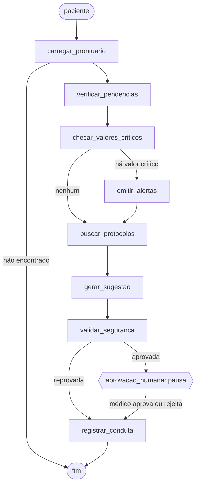

# Tech Challenge: Fase 3

Projeto da Fase 3 da Pós Tech IA para Devs (FIAP): assistente virtual médico de um hospital fictício, com fine-tuning de LLM em dados internos sintéticos e anonimizados, orquestrado com LangChain e LangGraph.

O enunciado completo está em [`desafio/`](desafio/).

## Objetivo

- Ajustar (fine-tuning) uma LLM aberta com protocolos, perguntas frequentes e modelos de documentos do hospital.
- Responder dúvidas clínicas contextualizadas com o prontuário do paciente, citando a fonte.
- Executar fluxos automatizados (exames pendentes, alertas, sugestões) com **aprovação humana obrigatória** antes de qualquer conduta.
- Registrar logs detalhados para auditoria.

## Estrutura

```
├── desafio/                      # enunciado do Tech Challenge
├── data/
│   ├── raw/                      # fontes internas do hospital fictício
│   │   ├── protocolos/           # 11 protocolos clínicos (Markdown, seções numeradas)
│   │   ├── modelos/              # 6 modelos de laudos, receitas e procedimentos
│   │   ├── faq.jsonl             # 56 perguntas frequentes de médicos (3 variações cada)
│   │   └── prontuarios.jsonl     # 200 prontuários brutos, COM dados pessoais fictícios
│   ├── processed/                # dados anonimizados e dataset de instruções
│   │   ├── prontuarios.jsonl     # prontuários anonimizados
│   │   ├── train/val/test.jsonl  # pares de instrução (formato chat)
│   │   └── relatorio_dados.json  # estatísticas de anonimização, curadoria e splits
│   └── eval/                     # conjuntos de avaliação (fora do treino)
│       ├── ataques.jsonl         # 30 pedidos de prescrição, injeções, fora de escopo e sem base
│       └── pubmedqa_200.jsonl    # amostra estratificada do PubMedQA
├── src/hospital_assistant/
│   ├── config.py                 # caminhos e serviços (variáveis de ambiente)
│   ├── prompts.py                # prompt de sistema e formato das mensagens (treino = inferência)
│   ├── data/                     # pipeline de dados
│   ├── finetune/                 # treino QLoRA e exportação para o Ollama
│   ├── db/                       # banco do prontuário (SQLite)
│   ├── rag/                      # busca semântica nos protocolos e avaliação da busca
│   ├── assistant/                # ferramentas LangChain, cadeia LCEL e montagem do contexto
│   ├── graph/                    # fluxos LangGraph (triagem e dúvida clínica) e diagramas
│   ├── safety/                   # travas de entrada e validação das respostas
│   ├── observability/            # trilha de auditoria por etapa (banco + log JSON)
│   ├── api.py                    # API web (FastAPI)
│   └── static/                   # front-end (HTML + JS, template Tabler)
├── docs/avaliacao/               # métricas (treino, busca)
├── docs/diagramas/               # diagramas Mermaid gerados a partir dos grafos
├── models/                       # adapter, modelo mesclado e GGUF (gerados, fora do git)
├── var/                          # banco e índice gerados em runtime (fora do git)
├── Dockerfile                    # imagem da app (só dependências de runtime)
├── docker-compose.yml            # ollama + importação do modelo + app
└── tests/                        # testes automatizados
```

A estrutura cresce a cada fase (fine-tuning, RAG, grafos, segurança e avaliação).

## Requisitos

- [uv](https://docs.astral.sh/uv/) (instala o Python 3.12 automaticamente)
- Docker com Docker Compose (para rodar a aplicação)
- Para treinar: GPU NVIDIA com pelo menos 4 GB de VRAM e driver com CUDA 12 ou superior

## Como rodar

```bash
uv sync            # cria o ambiente com todos os grupos (dados, treino, testes)
uv run pytest      # roda os testes
uv run ruff check  # lint
```

As dependências são separadas em grupos: o runtime da aplicação fica em `dependencies`; `data` (Faker, spaCy), `train` (PyTorch, Transformers, PEFT, TRL) e `dev` (pytest, ruff) são instalados localmente, mas não entram na imagem Docker.

## Dados

Todos os dados são **sintéticos**: o "Hospital Santa Aurora" é fictício e nenhum registro corresponde a pessoas reais. Os protocolos foram escritos com base em diretrizes clínicas públicas, apenas para fins acadêmicos, e **não devem ser usados na prática clínica**.

Para regenerar o dataset (determinístico, semente fixa):

```bash
uv run python -m hospital_assistant.data.pipeline   # prontuários, anonimização, dataset e splits
uv run python -m hospital_assistant.data.pubmedqa   # amostra de avaliação do PubMedQA (baixa da internet)
```

O pipeline faz, em ordem:

1. **Geração**: 200 prontuários brutos em 10 cenários clínicos, com nome, CPF, CNS, telefone, e-mail e endereço fictícios (gerados com Faker) para exercitar a anonimização.
2. **Pré-processamento**: normalização Unicode, remoção de caracteres de controle, padronização de unidades (mg/dL, mEq/L) e espaços.
3. **Anonimização** em três camadas:
   - identificadores conhecidos do próprio registro viram pseudônimos (`PAC-0001`, `[ACOMPANHANTE]`);
   - expressões regulares para CPF, CNS, telefone, e-mail e CEP;
   - reconhecimento de entidades do spaCy (`pt_core_news_md`) para nomes e locais que sobrarem.

   Campos identificadores são descartados, a data de nascimento vira idade e o mapeamento pseudônimo para pessoa não é salvo.
4. **Montagem** dos pares de instrução: perguntas frequentes, perguntas por seção de protocolo e modelo, perguntas contextualizadas com o prontuário (exames pendentes, valores críticos, alergias, resumo SBAR) e exemplos de segurança (recusa de prescrição, injeção de prompt, fora de escopo e "não encontrei nos protocolos"). Parte dos exemplos traz trechos de protocolo recuperados, inclusive um irrelevante, para o modelo aprender a citar a fonte certa.
5. **Curadoria**: deduplicação, limites de tamanho, validação das fontes citadas e nova busca por dados pessoais (exemplo com qualquer resíduo é descartado).
6. **Divisão** 80/10/10 por grupo e estratificada por tipo: variações da mesma pergunta e exemplos do mesmo paciente nunca ficam em splits diferentes.

O PubMedQA ([licença MIT](https://github.com/pubmedqa/pubmedqa)) é usado só na avaliação e é mantido em inglês: é um benchmark padrão, então mantê-lo no original permite comparar com a literatura e medir se o fine-tuning degradou o conhecimento geral do modelo.

## Fine-tuning

Modelo base: [Qwen2.5-1.5B-Instruct](https://huggingface.co/Qwen/Qwen2.5-1.5B-Instruct), escolhido por ser bom em português e caber numa GPU de 4 GB. O ajuste usa **QLoRA**:

- modelo base quantizado em 4 bits (NF4, dupla quantização) e congelado;
- adaptadores LoRA (rank 16, alpha 32, dropout 0,05) em todas as camadas lineares (18,5 milhões de parâmetros treináveis, cerca de 1,2% do modelo);
- loss calculada só sobre a resposta do assistente (formato prompt/completion);
- lote efetivo 16, gradient checkpointing, otimizador AdamW paginado em 8 bits, bf16, taxa de aprendizado 2e-4 com cosseno e aquecimento de 5%;
- contexto máximo de 1.024 tokens (o maior exemplo tem 954);
- 2 épocas (132 passos), avaliação e checkpoint a cada 20 passos.

```bash
uv run python -m hospital_assistant.finetune.train --max-steps 20   # teste rápido de memória e tempo
uv run python -m hospital_assistant.finetune.train                  # treino completo (models/adapter)
uv run python -m hospital_assistant.finetune.train --resume         # retoma do último checkpoint
uv run python -m hospital_assistant.finetune.export                 # mescla o adapter (models/merged)
```

O treino salva em `models/adapter/treino.json` a duração, o pico de VRAM e o histórico de loss. O histórico do treino oficial está em [`docs/avaliacao/treino.json`](docs/avaliacao/treino.json).

### Onde o modelo foi treinado

O script roda igual numa GPU local ou na nuvem. Numa RTX 3050 Ti de notebook (4 GB, limitada a ~20 W pelo firmware) o treino levaria mais de 2 horas; o treino oficial rodou numa **NVIDIA L4 do Google Colab** em **11 minutos** (pico de 2,1 GB de VRAM, lote 4 com acumulação 4), usando o [Colab CLI](https://github.com/googlecolab/google-colab-cli):

```bash
tar czf projeto.tgz src/hospital_assistant/__init__.py src/hospital_assistant/config.py \
    src/hospital_assistant/finetune data/processed/train.jsonl data/processed/val.jsonl
colab new -s treino --gpu L4
colab upload -s treino projeto.tgz /content/projeto.tgz
echo '!mkdir -p /content/proj && tar xzf /content/projeto.tgz -C /content/proj' | colab exec -s treino
colab install -s treino transformers==5.24.0 peft==0.22.0 trl==1.18.2 bitsandbytes==0.50.2 accelerate==1.16.0 datasets==5.2.0
colab restart-kernel -s treino
printf '%s\n' '%%bash' 'cd /content/proj && mkdir -p models/adapter && PYTHONPATH=src nohup python -m hospital_assistant.finetune.train --batch 4 --grad-accum 4 > models/adapter/train.log 2>&1 &' | colab exec -s treino
# ao terminar (aparece models/adapter/treino.json), baixar os arquivos do adapter:
for f in adapter_config.json adapter_model.safetensors treino.json train.log; do
  colab download -s treino /content/proj/models/adapter/$f models/adapter/$f
done
colab stop -s treino
```

Resultado: loss de validação de 1,23 para 0,19 e acerto de tokens de 74% para 96%.

## Prontuário e busca nos protocolos

**Banco estruturado.** Os prontuários anonimizados são carregados num SQLite (`pacientes`, `exames`, `alergias`, `medicacoes`) na primeira execução. O assistente só lê o banco, com consultas parametrizadas: o modelo nunca escreve SQL. O prontuário lido do banco gera exatamente o mesmo texto de contexto usado no treino (há um teste para isso).

**Busca semântica (RAG).** Cada seção de protocolo ou modelo vira um trecho com a referência usada nas citações (`PROT-SEPSE-01 §4`). Os embeddings vêm do [bge-m3](https://ollama.com/library/bge-m3), multilíngue, servido pelo próprio Ollama (a imagem da app não precisa de PyTorch). Com 85 trechos, um índice em memória basta; ele é salvo em `var/` e só é remontado quando os documentos mudam (montar leva ~40 s em CPU, carregar leva 0,1 s).

Avaliação da busca com as 168 perguntas frequentes (fontes corretas conhecidas):

| Estratégia | Fonte certa em 1º | Fonte certa entre os 3 |
|---|---|---|
| Busca semântica em todas as seções | 72,0% | 88,7% |
| Híbrida (semântica + BM25) | 65,5% | 86,3% |
| **Semântica sem a seção 1 (objetivo/indicação)** | **80,4%** | **91,7%** |

A seção 1 de cada documento resume o tema todo e ocupava o 1º lugar sem conter a resposta, por isso ficou fora do índice. Reproduzir: `uv run python -m hospital_assistant.rag.avaliar` (gera `docs/avaliacao/busca.json`). As mesmas perguntas foram usadas para escolher a estratégia, então os números são otimistas para perguntas novas.

**Contexto entregue ao modelo.** Sem paciente, vão os 3 trechos mais próximos da pergunta. Com paciente, vão o prontuário e 3 trechos intercalando duas buscas: só pela pergunta (encontra, por exemplo, a tabela de valores críticos) e pela pergunta mais o diagnóstico (encontra o protocolo do caso, para condutas).

## Fluxos com LangChain e LangGraph

**LangChain.** As consultas ao prontuário e aos protocolos são ferramentas LangChain (`assistant/ferramentas.py`: `consultar_prontuario`, `listar_exames_pendentes`, `verificar_valores_criticos`, `buscar_protocolos`), e a chamada ao modelo é uma cadeia LCEL (`prompt | modelo ajustado | parser`). As ferramentas são chamadas pelos nós em ordem fixa, não escolhidas pelo modelo: num fluxo clínico a sequência de verificações precisa ser garantida, e um modelo de 1,5B não faz tool-calling de forma confiável.

**Fluxo A: triagem automatizada** (`graph/triagem.py`). Ao receber um paciente, verifica pendências e valores críticos, emite alertas, busca o protocolo, gera a sugestão, valida e **pausa até o médico decidir**:



- Pendências e valores críticos são verificados **em código**, com os limites do `PROT-VCRIT-01 §2`. Na Fase 3 o modelo, sozinho, errava quais exames eram críticos.
- Os alertas são gravados no banco (`alertas`), com o identificador da execução.
- A sugestão reprovada na validação (fonte inexistente, conflito com alergia ou linguagem de prescrição com dose e via) não chega ao médico: é registrada como `bloqueada`.
- A pausa usa `interrupt` do LangGraph com checkpoint em SQLite: a execução pendente sobrevive a um reinício da aplicação. A decisão (aprovada ou rejeitada, médico, comentário) é gravada em `condutas`. Nada é registrado como conduta antes dela.

**Fluxo B: dúvida clínica** (`graph/duvida.py`): `verificar_entrada` -> (bloqueada) `responder_bloqueio`, ou `montar_contexto` (prontuário opcional + trechos) -> `gerar_resposta` -> `validar_resposta` -> (reprovada) `resposta_segura`.

Os diagramas gerados automaticamente pelo LangGraph estão em [`docs/diagramas/`](docs/diagramas/) (`uv run python -m hospital_assistant.graph.diagramas`).

## Segurança e auditoria

O assistente segue o `PROT-SEGMED-01` (limites de atuação do assistente virtual) com defesa em camadas:

| Camada | Onde | O que faz |
|---|---|---|
| Trava de entrada | `safety/entrada.py` | Pedido de prescrição (verbo de ação + alvo, ex.: "prescreva", "libera ... na bomba") e tentativa de burlar regras ("ignore", "sem validação", "você agora é") recebem a recusa padrão **sem chamar o modelo**. Pergunta geral muito distante de qualquer protocolo (similaridade < 0,42) recebe "não encontrei". |
| Modelo ajustado | fine-tuning | Treinado com exemplos de recusa, fora de escopo e "sem base". |
| Validação de saída | `safety/guardrails.py` | Reprova resposta sem fonte, com fonte inexistente, com fonte **fora dos trechos entregues ao modelo** (fundamentação), com conflito de alergia ou com prescrição (dose + via). Resposta reprovada não é mostrada: vira uma resposta segura, e a original fica na auditoria. |
| Valores críticos em código | `assistant/ferramentas.py` | O modelo não decide o que é crítico: os limites do `PROT-VCRIT-01 §2` são aplicados em código. |
| Protocolo do caso | `graph/triagem.py` | Na triagem, a conduta vem do protocolo registrado no prontuário, não do que a busca "achar". |
| Aprovação humana | `graph/triagem.py` | Nenhuma sugestão vale como conduta sem a decisão de um médico identificado. |

Calibração do limiar de "sem base" (com perguntas do treino, não do conjunto de avaliação): 0,42 bloqueia 1,2% das perguntas legítimas e pega 7 de 22 perguntas sem base; é conservador de propósito, porque as camadas seguintes cobrem o resto. A trava de entrada não teve nenhum falso positivo nas 168 perguntas frequentes e barrou os 100 pedidos de prescrição e injeções do treino.

No chat, a resposta só aparece depois de validada (sem streaming), para não exibir um texto que a validação ainda pode reprovar.

**Auditoria.** Cada etapa dos dois fluxos gera um evento com o `trace_id` da execução: dados produzidos pela etapa, texto exato enviado ao modelo, resposta original, versão do modelo, trechos e fontes, resultado da validação, decisão do médico (nome, aprovação, comentário) e duração. Os eventos ficam na tabela `auditoria` e também saem em JSON no log da aplicação (`docker compose logs app`). O prontuário completo não é copiado para o log, só o id do paciente.

Consultar:

- na interface, tela **Auditoria** (lista de execuções e trilha de cada uma; cada resposta do chat e cada triagem têm um link para a sua trilha);
- por linha de comando: `uv run python -m hospital_assistant.observability.auditoria` (últimas execuções) ou `... auditoria <trace_id>` (trilha completa).

## Aplicação (Docker)

```bash
uv run python -m hospital_assistant.finetune.export   # depois de treinar: gera models/merged
docker compose up -d --build
```

Sobe quatro serviços:

- `gguf`: converte `models/merged` para GGUF e quantiza em Q4_K_M com o [llama.cpp](https://github.com/ggml-org/llama.cpp) (só na primeira vez; o export apaga o GGUF antigo para forçar a reconversão);
- `ollama`: serve o modelo em CPU, como num servidor sem GPU;
- `ollama-init`: importa o GGUF no Ollama como `hospital-assistant`, baixa o `bge-m3` e encerra;
- `app`: API FastAPI e front-end em http://localhost:7860. Banco, índice e checkpoints dos fluxos ficam no volume `app_data`.

**Front-end.** Página única construída sobre o [Tabler](https://tabler.io) (template de painel administrativo, licença MIT, carregado por CDN em versão fixa), sem etapa de build. Telas:

- **Dúvida clínica**: chat com seletor de paciente, prontuário resumido (valores críticos em destaque), fontes como etiquetas, trechos consultados e aviso quando a resposta veio da trava de segurança ou foi substituída pela validação;
- **Triagem automática**: etapas do fluxo em linha do tempo, alertas críticos, pendências, sugestão com fontes e decisão do médico (nome e CRM obrigatórios);
- **Pacientes**: lista filtrável com contagem de valores críticos e prontuário de cada paciente;
- **Auditoria**: execuções recentes e trilha completa de cada uma.

Todo texto vindo do modelo é inserido como texto (nunca como HTML). A API (`/api/...`) tem documentação automática em http://localhost:7860/docs.

O Ollama também fica acessível em `127.0.0.1:11434` (só na própria máquina), para rodar avaliações e scripts locais.

A conversão para GGUF é feita antes porque o Ollama 0.40 importa safetensors só pelo motor MLX, que ainda não suporta a arquitetura Qwen2.

`OLLAMA_NUM_THREAD` (padrão 8) define quantas threads de CPU a inferência usa. Use o número de núcleos físicos da máquina: num notebook de 16 threads, o padrão do Ollama (todos os núcleos lógicos) gerou 3 tokens/s, contra 19 tokens/s com 8 threads.

Para comparar com o modelo original, sem fine-tuning:

```bash
docker compose exec ollama ollama pull qwen2.5:1.5b-instruct
MODEL_NAME=qwen2.5:1.5b-instruct docker compose up -d app
```

## Status

Em desenvolvimento.
