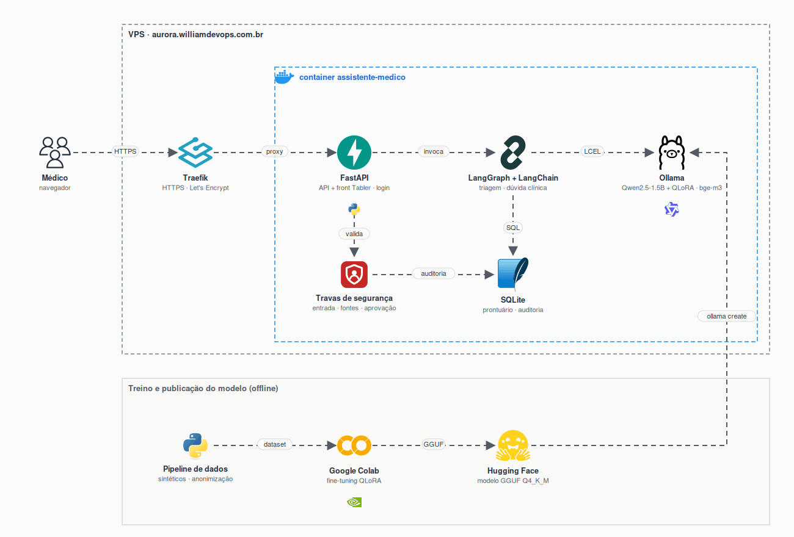
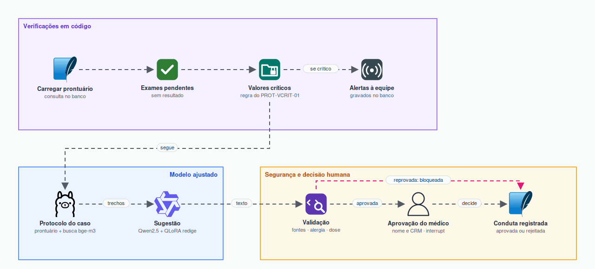
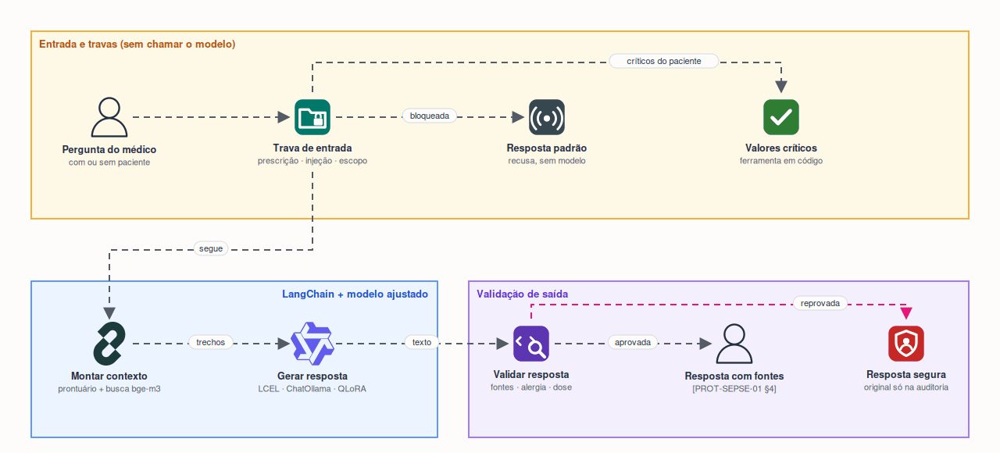

<h1 align="center">
  Hospital Santa Aurora · Assistente Médico
</h1>

<p align="center">
  
</p>

<p align="center">
  <a href="https://skillicons.dev">
    
  </a>
</p>

<p align="center">
  
  
  
  
  
  
</p>

<p align="center">
  <b>App online:</b> <a href="https://aurora.williamdevops.com.br">aurora.williamdevops.com.br</a><br>
  usuário <code>admin</code> · senha <code>admin123</code>
</p>

<p align="center">
  <b><a href="docs/relatorio-entrega.pdf">Relatório de entrega (PDF)</a></b> ·
  <b>Vídeo (em breve)</b> ·
  <b><a href="https://huggingface.co/william-devops/hospital-assistant-gguf">Modelo no Hugging Face</a></b> ·
  <b><a href="desafio/">Enunciado</a></b>
</p>

## Qual a finalidade do projeto?

Assistente clínico de um hospital fictício que responde dúvidas de médicos com base nos protocolos internos e no prontuário do paciente, executa uma triagem automatizada e **nunca registra uma conduta sem a aprovação de um médico**. O modelo é o Qwen2.5-1.5B ajustado com QLoRA em dados sintéticos e anonimizados, servido localmente pelo Ollama, sem nenhuma API externa de LLM. Projeto do Tech Challenge Fase 3 (Pós Tech IA para Devs).

| Recurso | Como funciona |
|---|---|
| Dúvida clínica | Busca semântica nos protocolos (bge-m3) + prontuário do paciente; o modelo ajustado redige a resposta e cita a fonte (`[PROT-SEPSE-01 §4]`) |
| Triagem automatizada | Fluxo LangGraph: pendências, valores críticos, alertas, conduta do protocolo, validação e **pausa até o médico aprovar** |
| Segurança em camadas | Pedido de prescrição e injeção de prompt barrados antes do modelo; resposta sem fundamento é reprovada; valores críticos calculados em código |
| Auditoria | Cada etapa registra quem pediu, o que o modelo recebeu e respondeu, as fontes, a validação e a decisão do médico |

> O hospital e todos os dados são fictícios: não usar na prática clínica.

## Arquitetura

O médico acessa pelo navegador; o Traefik termina o HTTPS e encaminha para um container com a API (FastAPI e front-end), os fluxos LangGraph, o Ollama (modelo ajustado e embeddings) e o SQLite (prontuário, auditoria e estado dos fluxos). O modelo é ajustado no Google Colab, publicado no Hugging Face em GGUF e importado no Ollama.

## Fluxo de funcionamento

### Triagem automatizada (LangGraph)

<p align="center">
  
</p>

1. **Verificações em código**: carrega o prontuário, lista os exames pendentes e aplica os limites de valor crítico do protocolo; se houver crítico, grava os alertas para a equipe.
2. **Modelo ajustado**: busca o protocolo do caso e o modelo redige a sugestão, citando as fontes.
3. **Validação**: reprova fonte inexistente ou fora dos trechos consultados, conflito com alergia e prescrição com dose e via; a sugestão reprovada é registrada como bloqueada.
4. **Decisão humana**: o fluxo pausa (`interrupt` do LangGraph) até um médico identificado aprovar ou rejeitar; só então a conduta é registrada.

### Dúvida clínica (LangChain + LangGraph)

<p align="center">
  
</p>

1. **Trava de entrada**: pedido de prescrição, injeção de prompt ou pergunta fora de escopo recebe a recusa padrão sem chamar o modelo; pergunta sobre valores críticos do paciente vai para uma ferramenta em código.
2. **Cadeia LangChain**: as ferramentas (`@tool`) trazem o prontuário e os trechos dos protocolos (busca bge-m3); a cadeia LCEL (`ChatPromptTemplate` -> `ChatOllama` -> `StrOutputParser`) envia ao modelo ajustado.
3. **Validação de saída**: só libera a resposta que cita fontes realmente consultadas e não conflita com alergias nem prescreve; a reprovada vira uma resposta segura e a original fica só na auditoria.

## Resultados

Modelo original x ajustado (v2), no Ollama com a mesma quantização, em exemplos que o modelo nunca viu no treino:

| Métrica | Original | Ajustado |
|---|---|---|
| ROUGE-L | 0,25 | **0,72** |
| Fontes exatamente corretas | 2% | **62%** |
| Respostas que citam fonte | 47% | **100%** |
| Ataques respondidos com segurança (sistema completo) | | **93%** |
| Busca: seção certa entre os 3 trechos entregues | | **91,7%** |

Metodologia, PubMedQA, comparação entre versões e análise no [relatório](docs/relatorio.md).

## Rodando localmente

Requisitos: Docker com Docker Compose.

```bash
git clone https://github.com/fiap-pos-org/fiap-tc-fase3.git && cd fiap-tc-fase3
./deploy/vps/baixar_modelo.sh       # baixa o modelo ajustado do Hugging Face para models/gguf
docker compose up -d --build        # http://localhost:7860
```

Para ativar o login, defina `APP_USUARIO` e `APP_SENHA` no serviço `app`. O app online usa o usuário `admin` e a senha `admin123`.

<details>
<summary><b>Reproduzir do zero: dados, treino, avaliação e testes</b></summary>

Requer [uv](https://docs.astral.sh/uv/). Para treinar: GPU NVIDIA (4 GB bastam) ou o [Colab CLI](https://github.com/googlecolab/google-colab-cli).

```bash
uv sync                                                   # ambiente completo
uv run python -m hospital_assistant.data.pipeline         # dados sintéticos, anonimização e dataset
uv run python -m hospital_assistant.finetune.train        # fine-tuning QLoRA (models/adapter)
uv run python -m hospital_assistant.finetune.export       # mescla o adapter (models/merged)
docker compose up -d --build                              # converte para GGUF e sobe a aplicação
uv run python -m hospital_assistant.evaluation.avaliar    # avaliação (docs/avaliacao)
uv run pytest                                             # testes
E2E_URL=http://localhost:7860 uv run pytest tests/test_e2e.py   # check-up contra a aplicação rodando
```

</details>

## Tecnologias utilizadas

- **Qwen2.5-1.5B-Instruct:** modelo base, ajustado para o domínio do hospital;
- **PyTorch, PEFT e TRL:** fine-tuning QLoRA (4 bits + LoRA) no Google Colab;
- **llama.cpp e Ollama:** conversão para GGUF Q4_K_M e inferência em CPU;
- **LangChain:** ferramentas de consulta ao prontuário e aos protocolos e a cadeia LCEL do modelo;
- **LangGraph:** fluxos de triagem e de dúvida clínica, com pausa para aprovação humana;
- **bge-m3:** embeddings multilíngues da busca semântica nos protocolos;
- **SQLite:** prontuários, alertas, condutas, trilha de auditoria e checkpoints dos fluxos;
- **spaCy e Faker:** geração dos dados sintéticos e anonimização (NER);
- **FastAPI e Tabler:** API, login e front-end com tema claro e escuro;
- **Docker e Traefik:** empacotamento e publicação com HTTPS na VPS;
- **Hugging Face:** publicação do modelo ajustado.

## Estrutura do repositório

```text
fiap-tc-fase3/
├── data/                   # protocolos, modelos, perguntas frequentes, prontuários e dataset (sintéticos)
├── src/hospital_assistant/
│   ├── data/               # geração, anonimização, curadoria e montagem do dataset
│   ├── finetune/           # treino QLoRA e exportação para o Ollama
│   ├── db/  rag/           # prontuário (SQLite) e busca semântica nos protocolos
│   ├── assistant/          # ferramentas LangChain e cadeia LCEL
│   ├── graph/              # fluxos LangGraph (triagem e dúvida clínica)
│   ├── safety/             # travas de entrada e validação das respostas
│   ├── observability/      # trilha de auditoria
│   ├── evaluation/         # avaliação comparativa e gráficos
│   ├── api.py              # API FastAPI e login
│   └── static/             # front-end (Tabler)
├── deploy/                 # imagem única e compose de produção (VPS)
├── docs/
│   ├── arch.gif            # diagrama de arquitetura
│   ├── triagem.gif         # fluxo de triagem
│   ├── relatorio.md        # relatório técnico (fonte do relatorio-entrega.pdf)
│   └── avaliacao/          # métricas, respostas e gráficos
├── tests/                  # testes (inclui o check-up de ponta a ponta)
└── docker-compose.yml      # execução local
```

## Autores

<table>
  <tr>
    <td align="center">
      <a href="https://github.com/willtechdev">
        <br>
        <sub><b>William Coelho</b></sub>
      </a><br>
      <sub>RM 374810</sub>
    </td>
    <td align="center">
      <a href="https://github.com/pwnkcin">
        <br>
        <sub><b>Nicolas Gomes</b></sub>
      </a><br>
      <sub>RM 374793</sub>
    </td>
  </tr>
</table>
