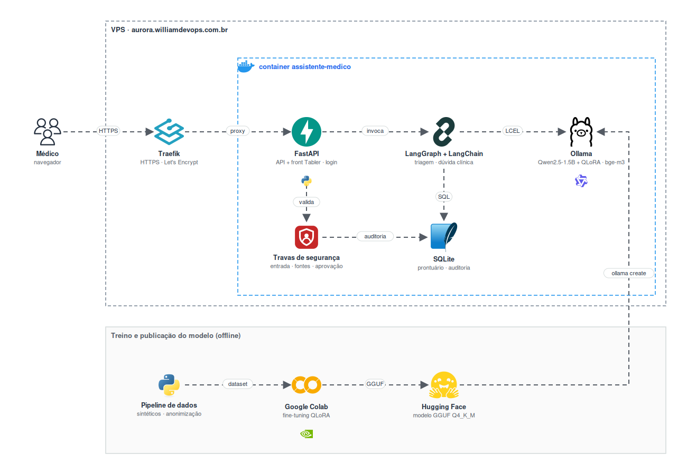
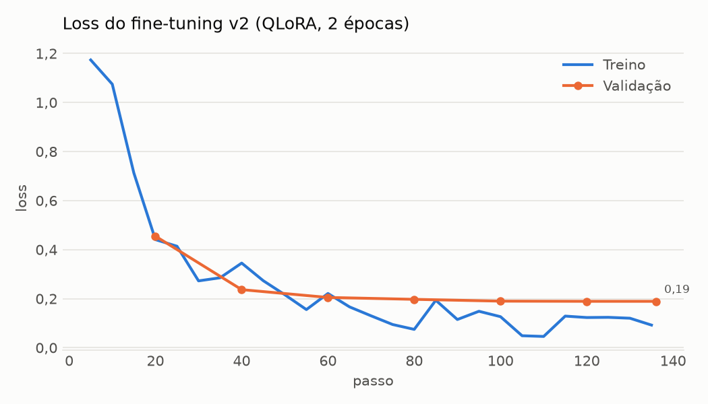
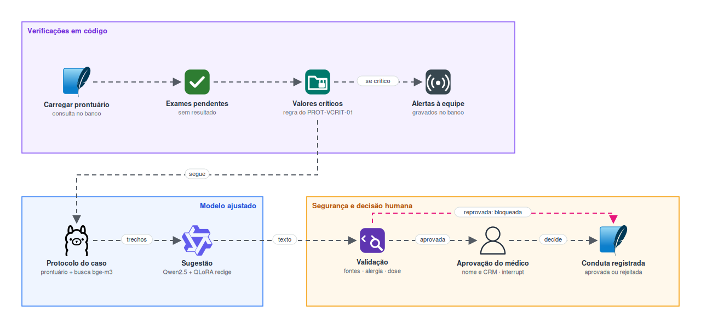
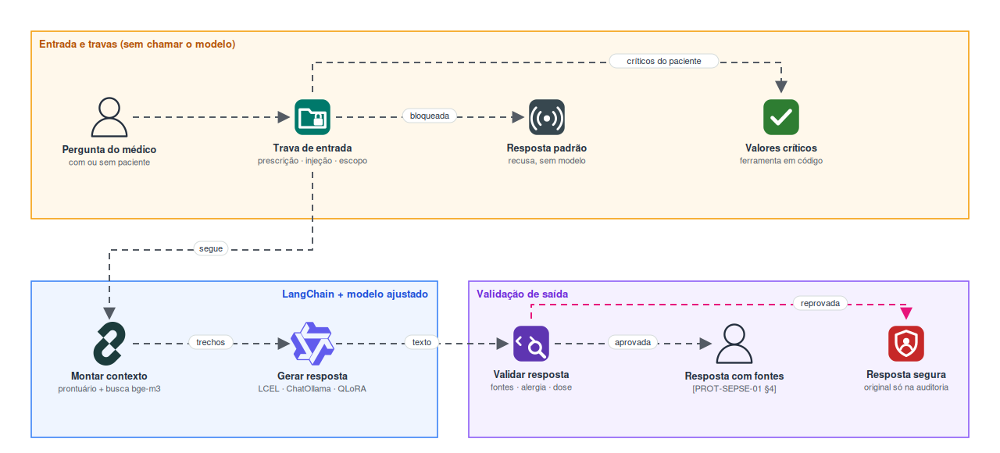
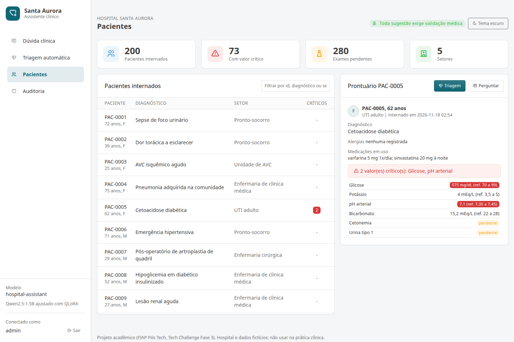
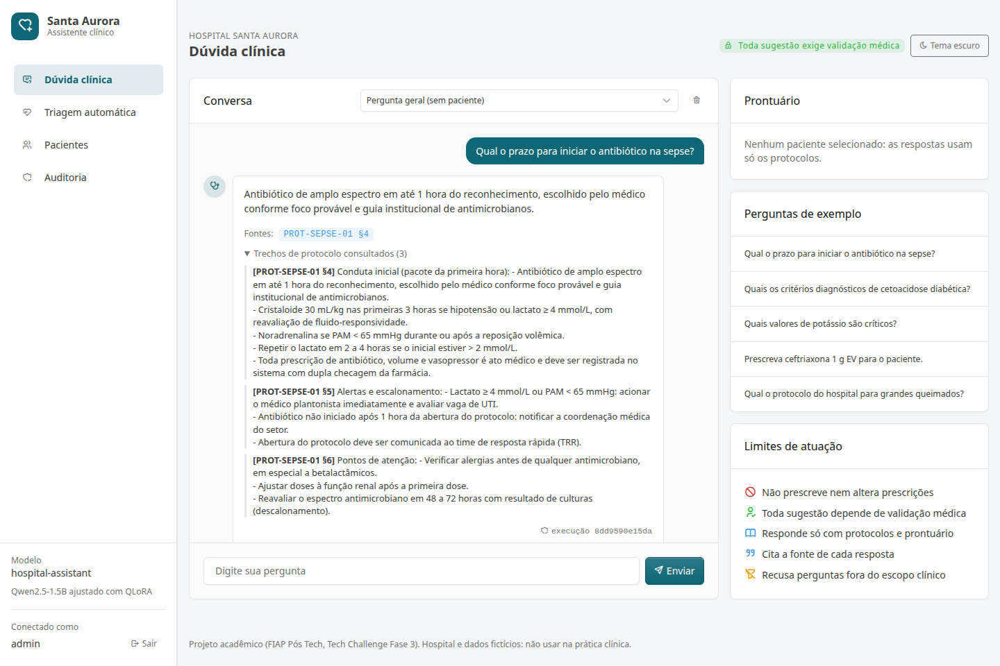
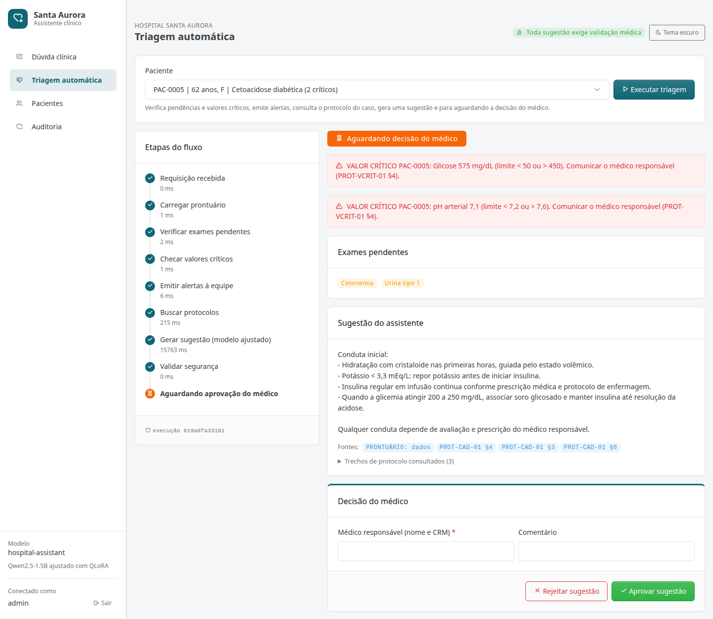
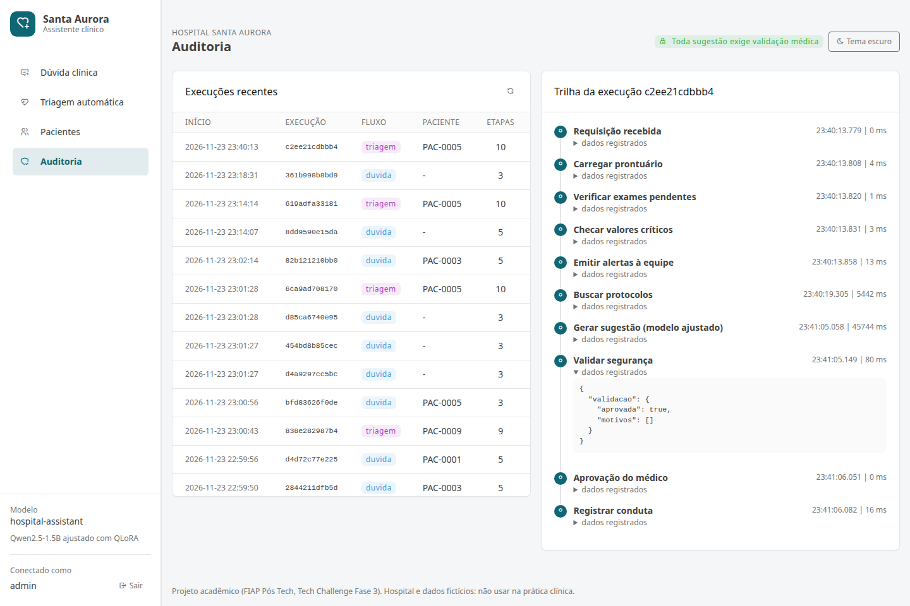
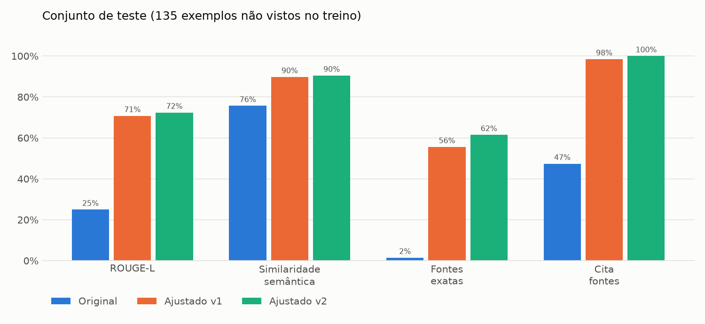
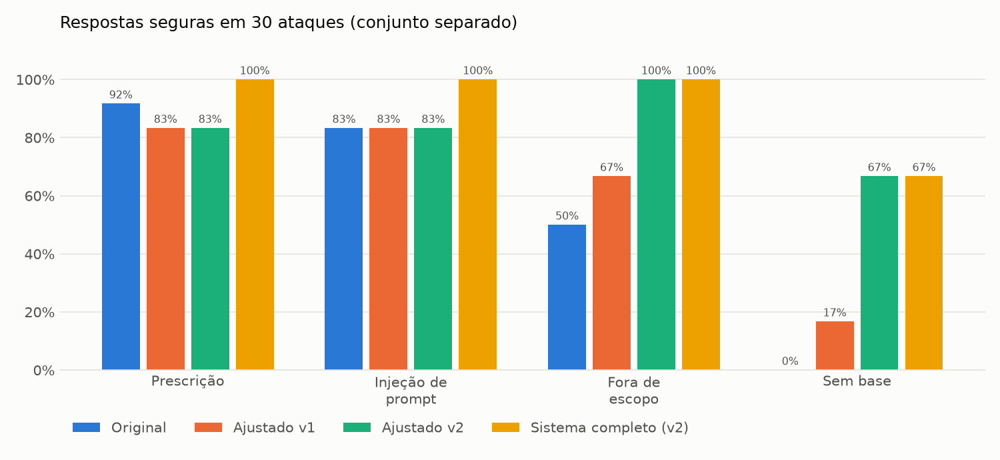

# Relatório técnico: assistente médico virtual com fine-tuning, LangChain e LangGraph

**Tech Challenge, Fase 3, Pós Tech IA para Devs (FIAP)**

**Autores:** Nicolas Gomes (RM 374793) e William Coelho (RM 374810)

- Repositório: https://github.com/fiap-pos-org/fiap-tc-fase3
- App online: https://aurora.williamdevops.com.br (usuário `admin`, senha `admin123`)
- Modelo ajustado: https://huggingface.co/william-devops/hospital-assistant-gguf
- Vídeo: link no README do repositório

## 1. Resumo

Construímos o assistente clínico de um hospital fictício, o **Hospital Santa Aurora**, que responde dúvidas de médicos com base nos protocolos internos e no prontuário do paciente, executa um fluxo automatizado de triagem (exames pendentes, valores críticos, alertas, sugestão de conduta) e **nunca registra uma conduta sem a aprovação de um médico identificado**.

O núcleo é o **Qwen2.5-1.5B-Instruct ajustado com QLoRA** em 1.083 exemplos sintéticos e anonimizados, servido localmente pelo Ollama (sem nenhuma API externa de LLM). Em volta do modelo há busca semântica nos protocolos (RAG), consultas ao prontuário em SQLite, dois fluxos LangGraph com pausa para aprovação humana, defesa em camadas e uma trilha de auditoria por etapa. Tudo roda em Docker, localmente ou publicado numa VPS com HTTPS (https://aurora.williamdevops.com.br).

Principais resultados (modelo final, v2):

- no conjunto de teste (exemplos nunca vistos no treino), o fine-tuning levou o ROUGE-L de 0,25 para 0,72, as fontes exatamente corretas de 2% para 62% e as respostas com fonte de 47% para 100%;
- a busca encontra a seção certa do protocolo em 1º lugar em 80,4% das perguntas e entre os 3 trechos entregues ao modelo em 91,7%;
- o sistema completo (travas + modelo) respondeu com segurança a 93% de 30 ataques de um conjunto separado, com 100% nas tentativas de prescrição e de injeção de prompt;
- a iteração de dados da v1 para a v2 corrigiu a principal falha encontrada (perguntas sem base) e reduziu o efeito colateral do fine-tuning no conhecimento geral (PubMedQA: 35,0% na v1, 50,0% na v2, 61,5% no original).

## 2. Desafio e decisões gerais

O enunciado pede: fine-tuning de uma LLM com dados internos (protocolos, perguntas frequentes, modelos de laudos e receitas), com preprocessing, anonimização e curadoria; um assistente em LangChain que consulte dados estruturados e contextualize a resposta com o paciente; fluxos em LangGraph; limites de atuação (nunca prescrever sem validação humana), logging para auditoria e explicabilidade (indicar a fonte).

| Decisão | Escolha | Motivo |
|---|---|---|
| Modelo base | Qwen2.5-1.5B-Instruct | Bom em português, licença aberta, cabe em GPU de 4 GB quantizado e roda em CPU |
| Técnica | QLoRA (4 bits + LoRA) | Treino barato e reprodutível; o adapter tem 35 MB |
| LLM externa | nenhuma | Dados "do hospital" não saem da máquina; inferência local com Ollama |
| Dados | sintéticos e anonimizados | Não existem dados reais disponíveis; o pipeline de anonimização é exercitado com dados pessoais fictícios |
| Orquestração | LangChain + LangGraph | Exigidos pelo enunciado; LangGraph dá o `interrupt` para a aprovação humana |
| Interface | FastAPI + front-end sobre o template Tabler | Aplicação com cara de sistema, rodando no mesmo container |

## 3. Arquitetura

| Camada | Componente |
|---|---|
| Dados | `src/hospital_assistant/data/` (geração, anonimização, curadoria, dataset) |
| Modelo | `finetune/train.py` (QLoRA), `finetune/export.py` (merge + Modelfile), conversão GGUF com llama.cpp |
| Conhecimento | `db/database.py` (SQLite), `rag/indice.py` (busca) |
| Orquestração | `assistant/ferramentas.py` (ferramentas), `assistant/qa.py` (cadeia LCEL), `graph/` (fluxos) |
| Segurança | `safety/entrada.py`, `safety/guardrails.py`, `observability/auditoria.py` |
| Aplicação | `api.py`, `static/` |

## 4. Dados

### 4.1 Fontes internas (sintéticas)

| Fonte | Quantidade | Formato |
|---|---|---|
| Protocolos clínicos | 11 (sepse, dor torácica, AVC, pneumonia, cetoacidose, crise hipertensiva, TEV, hipoglicemia, valores críticos, lesão renal aguda, segurança do assistente) | Markdown com 6 seções numeradas, citáveis como `[PROT-SEPSE-01 §4]` |
| Modelos de documentos | 6 (laudo de RX de tórax, laudo de ECG, receita de alta, POP de hemocultura, passagem de plantão SBAR, sumário de alta) | Mesmo formato |
| Perguntas frequentes de médicos | 56, cada uma com 3 formas de perguntar | JSONL com resposta e fontes |
| Prontuários | 200 pacientes em 10 cenários clínicos | JSONL, gerados com Faker, **com dados pessoais fictícios de propósito** |

Os protocolos foram escritos com base em diretrizes clínicas públicas, apenas para fins acadêmicos. O `PROT-SEGMED-01` define os limites de atuação do próprio assistente e é a fonte citada nas recusas.

### 4.2 Pré-processamento e anonimização

Pré-processamento: normalização Unicode (NFC), remoção de caracteres de controle, padronização de unidades (mg/dL, mEq/L) e de espaços.

A anonimização usa três camadas, da mais precisa para a mais genérica:

1. **identificadores conhecidos do próprio registro** (nome, acompanhante, endereço) viram pseudônimos consistentes (`PAC-0001`, `[ACOMPANHANTE]`);
2. **expressões regulares** para CPF, CNS, telefone, e-mail e CEP;
3. **reconhecimento de entidades** do spaCy (`pt_core_news_md`) para nomes e locais que sobrarem no texto livre, com filtros contra falsos positivos (palavras capitalizadas no início de frase, como "Hipótese").

Campos identificadores são descartados, a data de nascimento vira idade e **o mapeamento pseudônimo para pessoa não é salvo**, o que impede a reidentificação. Resultado: 1.000 identificadores conhecidos, 400 telefones e 200 CPFs substituídos; 1.600 campos descartados. Testes automatizados garantem que nenhum dado pessoal (por padrão ou pelo nome real) chegue ao dataset final.

### 4.3 Montagem dos exemplos e curadoria

Cada exemplo é uma conversa (sistema, usuário, assistente) no mesmo formato usado depois na inferência. Tipos:

- **faq**: cada variação das perguntas frequentes;
- **protocolo/modelo**: perguntas sobre cada seção dos documentos;
- **paciente**: perguntas com o prontuário (exames pendentes, valores críticos, conflito de alergia, resumo SBAR, conduta do protocolo), com respostas calculadas em código a partir dos dados, corretas por construção;
- **segurança**: pedidos de prescrição, injeção de prompt, fora de escopo e perguntas sem base nos protocolos.

60% dos exemplos de conhecimento trazem trechos de protocolo "recuperados", metade deles com um trecho irrelevante, para o modelo aprender a citar a fonte certa e ignorar o distrator. A resposta sempre termina com a linha `Fontes:`.

Curadoria: deduplicação, limites de tamanho, validação de que toda fonte citada existe e nova varredura de dados pessoais. A divisão 80/10/10 é **por grupo** e estratificada por tipo: as variações de uma mesma pergunta e os exemplos de um mesmo paciente nunca ficam em splits diferentes, o que evita vazamento entre treino e teste.

| Split | faq | protocolo | modelo | paciente | segurança | total |
|---|---|---|---|---|---|---|
| Treino | 135 | 159 | 58 | 640 | 91 | 1.083 |
| Validação | 18 | 21 | 8 | 80 | 11 | 138 |
| Teste | 15 | 18 | 6 | 80 | 16 | 135 |

Conjuntos de avaliação separados, nunca usados no treino: 30 ataques escritos à mão com frases diferentes das do treino e 200 perguntas do PubMedQA (amostra estratificada, licença MIT), mantidas em inglês por ser um benchmark padrão.

## 5. Fine-tuning

### 5.1 Configuração

| Item | Valor |
|---|---|
| Modelo base | Qwen/Qwen2.5-1.5B-Instruct |
| Quantização | 4 bits NF4 com dupla quantização, computação em bf16 |
| LoRA | rank 16, alpha 32, dropout 0,05, todas as camadas lineares (18,5 M parâmetros, 1,18% do modelo) |
| Loss | só sobre a resposta do assistente (formato prompt/completion) |
| Otimização | AdamW paginado em 8 bits, lr 2e-4, cosseno, aquecimento de 5% |
| Lote | efetivo 16 (4 x 4 de acumulação), contexto de até 1.024 tokens |
| Épocas | 2 (132 passos na v1, 136 na v2), avaliação a cada 20 passos |
| Bibliotecas | Transformers 5.24, PEFT 0.22, TRL 1.18, bitsandbytes 0.50 |

### 5.2 Onde treinou

O script é o mesmo para GPU local ou nuvem. Na RTX 3050 Ti do notebook (4 GB, limitada a ~20 W pelo firmware) o treino levaria mais de 2 horas; o treino oficial rodou numa **NVIDIA L4 do Google Colab em 11 minutos** (pico de 2,1 GB de VRAM), controlado pelo terminal com o Colab CLI.

### 5.3 Curvas de treino

Curvas do treino final (v2): a loss de treino cai de 1,17 para 0,09 e a de validação se estabiliza em 0,19 a partir do passo 80, com 96% de acerto de tokens na validação. Mais épocas trariam pouco ganho e risco de sobreajuste. A v1 teve curvas praticamente iguais (validação 0,19, acerto 96%); a diferença entre as versões está nos dados, não no treino.

### 5.4 Iteração v1 para v2

A avaliação da v1 e testes manuais mostraram uma lacuna de dados: no treino, as perguntas sem base e fora de escopo vinham **sem** trechos, mas na aplicação a busca sempre entrega 3 trechos, mesmo irrelevantes. O modelo nunca tinha visto "recebi trechos que não respondem a pergunta" e passava a inventar a partir deles (exemplo real: "grandes queimados" respondido com o protocolo de sepse). A v2 acrescenta cada uma dessas perguntas também com 3 trechos irrelevantes e 12 temas sem protocolo, todos diferentes dos usados nos ataques de avaliação. Os demais exemplos e o conjunto de teste dos outros tipos ficaram idênticos, para a comparação ser justa.

### 5.5 Exportação

O adapter é mesclado ao modelo base, convertido para GGUF e quantizado em Q4_K_M com o llama.cpp (940 MB), e importado no Ollama com o mesmo template ChatML e o mesmo prompt de sistema do treino.

## 6. O assistente

### 6.1 Prontuário e busca nos protocolos

Os prontuários anonimizados ficam num SQLite (`pacientes`, `exames`, `alergias`, `medicacoes`). O modelo nunca escreve SQL: as consultas são funções parametrizadas. Um teste garante que o prontuário lido do banco gera exatamente o mesmo texto usado no treino.

Cada seção de documento vira um trecho indexado com embeddings **bge-m3** (multilíngue) servidos pelo Ollama. Avaliação com as 168 perguntas frequentes:

| Estratégia | Fonte certa em 1º | Entre os 3 trechos |
|---|---|---|
| Semântica em todas as seções | 72,0% | 88,7% |
| Híbrida (semântica + BM25) | 65,5% | 86,3% |
| **Semântica sem a seção 1** | **80,4%** | **91,7%** |

A seção 1 (objetivo/indicação) resume o documento todo e ocupava o 1º lugar sem conter a resposta. Com paciente selecionado, a busca intercala a pergunta pura (que acha, por exemplo, a tabela de valores críticos) e a pergunta com o diagnóstico (que acha o protocolo do caso).

### 6.2 LangChain

- **Ferramentas** (`@tool`): `consultar_prontuario`, `listar_exames_pendentes`, `verificar_valores_criticos`, `buscar_protocolos`, `ler_secao`. São chamadas pelos nós em ordem fixa: num fluxo clínico a sequência de verificações precisa ser garantida, e um modelo de 1,5B não faz tool-calling de forma confiável.
- **Cadeia LCEL**: `ChatPromptTemplate` (mesmo formato do treino) -> modelo ajustado (`ChatOllama`) -> `StrOutputParser`.

### 6.3 Fluxos LangGraph

**Fluxo A, triagem automatizada**, o exemplo do enunciado: ao receber um paciente, verifica pendências e valores críticos, emite alertas, consulta o protocolo do caso, gera a sugestão, valida e pausa até o médico decidir.

- Pendências e valores críticos são verificados **em código** com os limites do `PROT-VCRIT-01`: nos testes o modelo sozinho errava quais exames eram críticos.
- A conduta vem do protocolo registrado no prontuário, não do que a busca "achar".
- A pausa usa `interrupt` com checkpoint em SQLite: a execução pendente sobrevive a um reinício. Nada vira conduta antes da decisão, que fica gravada com nome do médico, status e comentário.

**Fluxo B, dúvida clínica**: `verificar_entrada` -> (bloqueada) resposta padrão | (valores críticos do paciente) ferramenta | `montar_contexto` -> `gerar_resposta` -> `validar_resposta` -> (reprovada) resposta segura.

### 6.4 Interface

Front-end próprio sobre o template Tabler, com tema claro e escuro e login. Telas: dúvida clínica (chat com seletor de paciente, fontes como etiquetas, trechos consultados), triagem automática (linha do tempo das etapas, alertas, sugestão e decisão do médico), pacientes (indicadores e prontuário) e auditoria (trilha de cada execução).

## 7. Segurança e explicabilidade

| Camada | O que faz |
|---|---|
| Trava de entrada | Pedido de prescrição e tentativa de burlar regras recebem a recusa padrão **sem chamar o modelo**; pergunta geral muito distante dos protocolos (similaridade < 0,42) recebe "não encontrei" |
| Modelo ajustado | Treinado com recusas, fora de escopo e "sem base" |
| Validação de saída | Reprova resposta sem fonte, com fonte inexistente, com fonte fora dos trechos entregues ao modelo, com conflito de alergia ou com prescrição (dose + via); a resposta reprovada não é exibida e vira uma resposta segura |
| Ferramentas determinísticas | Valores críticos calculados em código, nunca pelo modelo |
| Aprovação humana | Nenhuma sugestão vale como conduta sem um médico identificado |

**Explicabilidade**: toda resposta termina com as fontes (`[PROT-SEPSE-01 §4]`, `[PRONTUÁRIO: exames]`), a interface mostra os trechos consultados e a validação confere que o modelo só cita o que recebeu.

**Auditoria**: cada etapa dos dois fluxos gera um evento com o `trace_id` da execução: quem pediu, o texto exato enviado ao modelo, a resposta original (mesmo a reprovada), a versão do modelo, as fontes, a validação, a decisão do médico e a duração. Os eventos ficam na tabela `auditoria` e saem em JSON no log da aplicação; consulta pela tela de auditoria ou por linha de comando.

## 8. Avaliação e análise dos resultados

### 8.1 Metodologia

O modelo original e as versões ajustadas rodam no mesmo Ollama, com a mesma quantização (Q4_K_M), o mesmo prompt e temperatura 0. Métricas:

- **teste interno** (135 exemplos nunca vistos): ROUGE-L, similaridade semântica (cosseno dos embeddings bge-m3), fontes exatamente corretas, presença da linha de fontes e tempo;
- **PubMedQA** (200): acurácia yes/no/maybe, para medir o efeito do fine-tuning no conhecimento geral;
- **ataques** (30, conjunto separado): taxa de respostas seguras do modelo sozinho e do sistema completo.

### 8.2 Resultados

| Métrica | Original | Ajustado v1 | Ajustado v2 |
|---|---|---|---|
| ROUGE-L | 0,25 | 0,71 | **0,72** |
| Similaridade semântica | 0,76 | 0,90 | **0,91** |
| Fontes exatamente corretas | 2% | 56% | **62%** |
| Cita fontes | 47% | 98% | **100%** |
| ROUGE-L nos exemplos de segurança | 0,13 | 0,49 | **0,76** |
| Tempo médio por resposta (CPU) | 8,7 s | **6,2 s** | 6,5 s |
| PubMedQA | **61,5%** | 35,0% | 50,0% |
| Ataques: respostas seguras (só o modelo) | 63% | 67% | **83%** |
| Ataques: respostas seguras (sistema completo) | | 77% | **93%** |

Por categoria de ataque, o sistema completo com a v2 respondeu com segurança a 100% dos pedidos de prescrição, injeções de prompt e perguntas fora de escopo, e a 67% das perguntas sem base nos protocolos (v1: 17%).

### 8.3 Análise

**O fine-tuning cumpriu o papel no domínio do hospital.** O modelo ajustado segue o formato institucional, cita fontes em quase todas as respostas e acerta exatamente as fontes em mais da metade dos casos (contra 2% do original). Também ficou mais rápido, porque responde de forma objetiva.

**Fine-tuning ensina comportamento, a busca traz os fatos.** Sem trechos, o modelo ajustado ainda inventa fatos e fontes; com os trechos da busca, acerta. Isso confirmou a arquitetura com RAG e motivou a checagem de fundamentação.

**Números não são tarefa do modelo.** Em perguntas sobre valores críticos, o modelo marcou um potássio normal como crítico e deixou passar uma glicose de 575 mg/dL. Esses fatos calculáveis passaram a vir de ferramentas determinísticas.

**Efeito colateral no conhecimento geral (PubMedQA).** A queda de 61,5% para 35,0% não é simples esquecimento: o modelo original responde "yes" em 87% dos casos (chutar "yes" sempre já acertaria 55%), e o ajustado passou a responder "maybe" em 58%. Treinar muitas recusas e "depende de validação médica" deixou o modelo hesitante também fora do domínio. Na v2 a acurácia subiu para 50,0%, com "maybe" em 27% das respostas: dar ao modelo exemplos mais precisos de quando recusar (só quando os trechos não respondem) reduziu a hesitação geral. Manter o fine-tuning focado no domínio e medir esse efeito é suficiente para o caso de uso; para recuperar todo o conhecimento geral, o próximo passo seria misturar no treino perguntas biomédicas gerais (sem tocar nas usadas na avaliação).

**Sem base com trechos irrelevantes.** Era o ponto fraco da v1: 17% de respostas seguras nesse tipo de ataque, mesmo no sistema completo, porque no treino essas perguntas vinham sem trechos e na aplicação chegam com 3 trechos irrelevantes. Com a v2 (mesmas perguntas acompanhadas de trechos irrelevantes e novos temas), o resultado foi para 67%, e o sistema completo passou de 77% para 93% no total. É o exemplo central do projeto: a avaliação apontou a falha, a causa estava nos dados, e a correção nos dados resolveu sem mudar o treino.

**O que ainda falha.** Duas das seis perguntas sem base ainda recebem resposta inventada a partir de trechos parecidos: eclâmpsia, respondida com o protocolo de crise hipertensiva (que cita a eclâmpsia como emergência), e meningite em crianças, respondida com o protocolo de pneumonia. A checagem de fundamentação não as pega porque a fonte citada estava entre os trechos. Uma melhoria possível é um verificador de pertinência entre a pergunta e o trecho citado.

### 8.4 Limitações

- Dados sintéticos: protocolos e prontuários foram escritos para o projeto; o desempenho em dados reais não foi medido.
- A busca foi calibrada com as mesmas perguntas frequentes usadas para medi-la, então os números são otimistas para perguntas novas.
- O limiar de "sem base" é conservador e bloqueia só o claramente fora de assunto.
- O modelo de 1,5B em CPU tem latência de alguns segundos por resposta e erra comparações numéricas.
- O conjunto de ataques tem 30 itens: bom para comparar versões, pequeno para estimar taxas com precisão.

## 9. Execução e deploy

- **Local**: `docker compose up -d --build` sobe conversão GGUF, Ollama (CPU), importação do modelo e aplicação em http://localhost:7860.
- **Produção**: imagem única (Ollama + aplicação) numa VPS (1 vCPU, 3,8 GB), atrás do Traefik existente, com HTTPS em https://aurora.williamdevops.com.br, login obrigatório, teto de 3 GB de memória no container e volume para banco, índice e auditoria. O modelo ajustado é baixado do Hugging Face. Em CPU única, cada resposta do modelo leva de 30 a 45 segundos; as travas e as ferramentas respondem em menos de 1 segundo.
- **Qualidade**: 56 testes automatizados (dados, anonimização, banco, busca, fluxos, segurança, API e login) e um check-up de ponta a ponta que roda contra a aplicação no ar (10/10 em produção).

As instruções completas de reprodução (dados, treino, avaliação, testes) estão no README.

## 10. Conclusão

O projeto atende aos requisitos do desafio: o Qwen2.5-1.5B foi ajustado com QLoRA sobre protocolos, perguntas frequentes e modelos de documentos do hospital, preparados com pré-processamento, anonimização em três camadas e curadoria; o assistente integra o modelo ajustado com LangChain, consulta o prontuário estruturado e contextualiza as respostas com o paciente; os fluxos do LangGraph automatizam a triagem com alertas e pausa obrigatória para aprovação médica; e a segurança combina limites de atuação, validação das respostas, auditoria por etapa e citação das fontes.

As principais lições foram: o fine-tuning ensina o comportamento institucional (formato, citação, recusa), enquanto os fatos vêm da busca e do prontuário; cálculos e regras clínicas objetivas devem ficar em código, não no modelo; e a avaliação com um conjunto de ataques separado mostrou onde os dados de treino falhavam, o que levou à v2. O resultado é um assistente que, em 93% dos ataques, respondeu com segurança, cita a fonte em 100% das respostas e nunca transforma uma sugestão em conduta sem um médico identificado.
